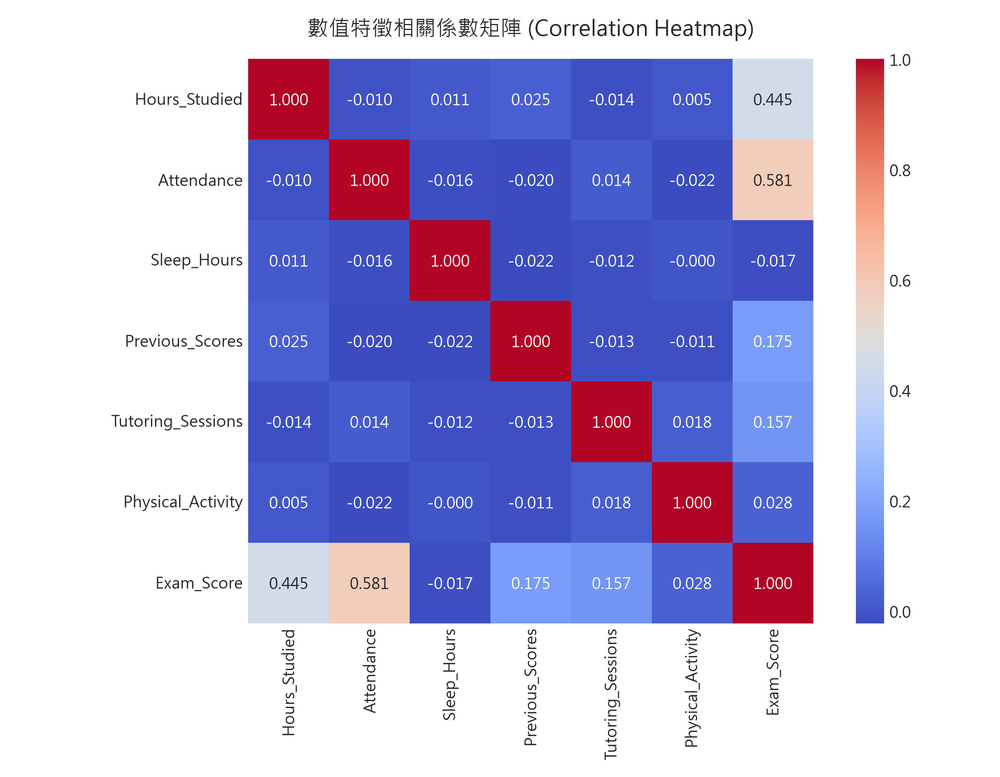
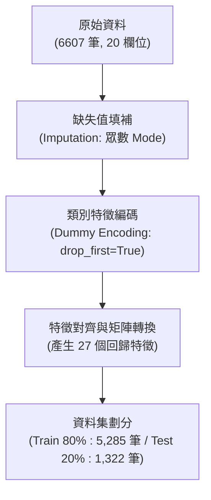
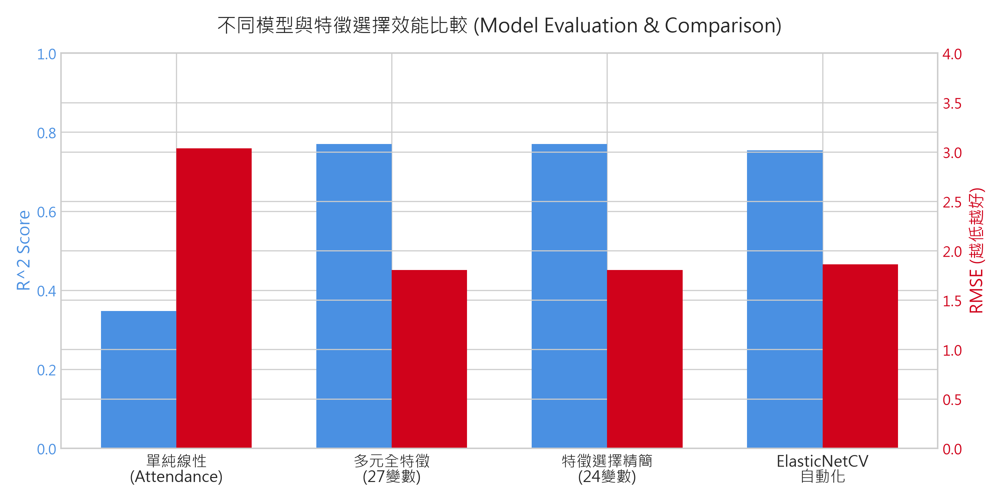
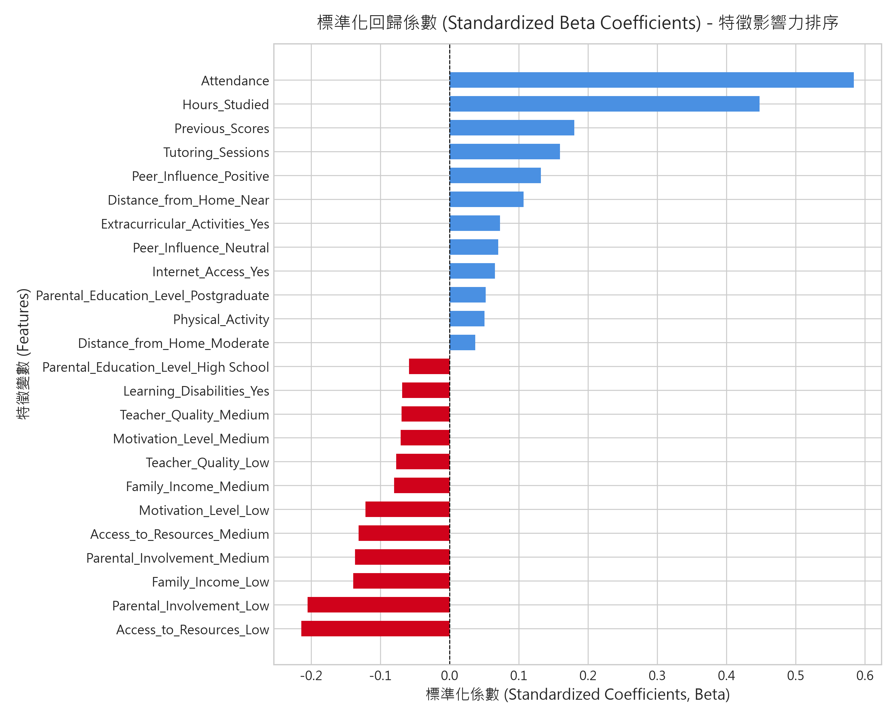
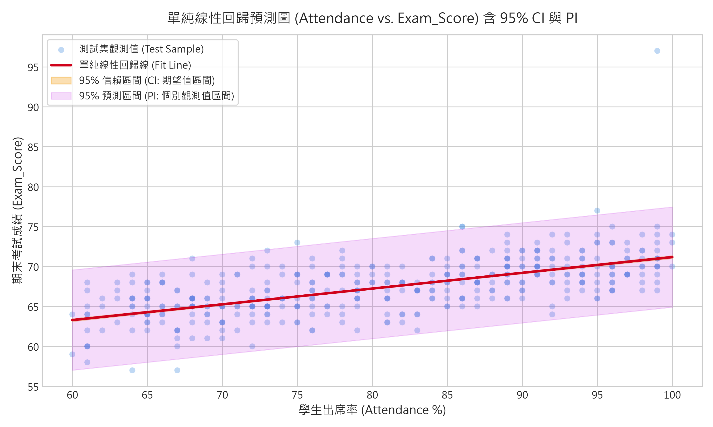
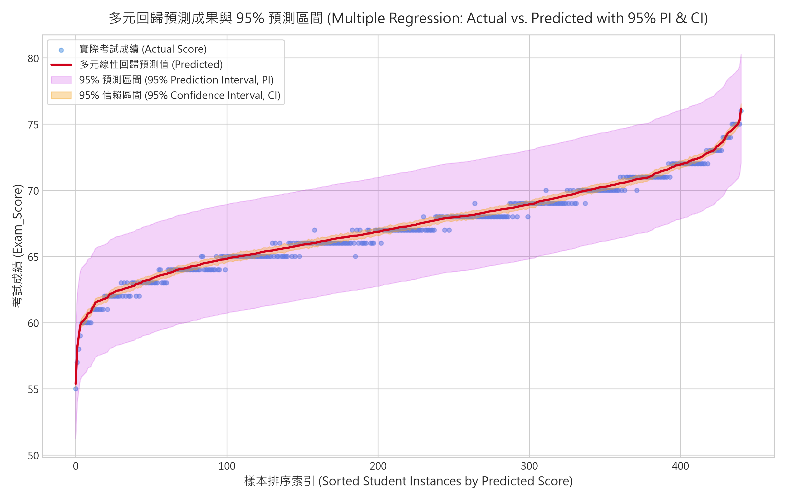
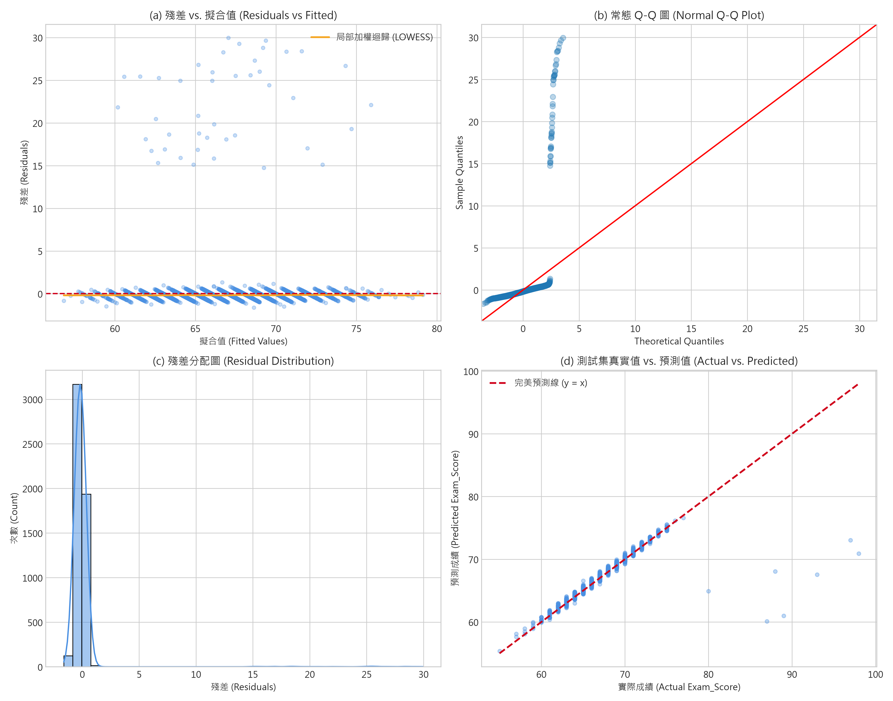

# 學生學業成績預測分析 (Student Performance Factors Regression Analysis)
> 基於 CRISP-DM 流程之線性回歸 (Linear Regression) 建模、特徵選擇、區間估計與教育決策分析

---

## 🔗 專案連結與線上展示 (Links & Live Demo)
* 🌐 **GitHub Pages (Live Demo)**: [https://kouou24.github.io/HW2_Linear_regression/](https://kouou24.github.io/HW2_Linear_regression/)
* 📦 **GitHub Repository**: [https://github.com/Kouou24/HW2_Linear_regression](https://github.com/Kouou24/HW2_Linear_regression)
* 🌐 **Result**:

---

## 🌐 互動展示網頁 (Interactive Demo)
本專案附帶可獨立執行的現代化響應式互動網頁應用程式 [`index.html`](./index.html)，具備以下核心功能：
1. **即時推論計算機 (Inference Calculator)**：可自由調整出席率、自修時數、過去成績與選擇各項家庭/環境屬性，即時以多元回歸公式推算期末預期成績。
2. **統計區間動態評估**：同時計算並動態呈現 **95% 信賴區間 (CI: 群體期望值估計)** 與 **95% 預測區間 (PI: 個別學生波動範圍)**。
3. **典型學生情境預設**：內建「範例一：高學習投入學生」與「範例二：潛在高風險/需輔導學生」一鍵帶入。
4. **模型評估與視覺化圖表全覽**：內建所有高解析圖表畫廊與指標對照表。

* 🚀 **線上直接體驗 (GitHub Pages)**: [https://kouou24.github.io/HW2_Linear_regression/](https://kouou24.github.io/HW2_Linear_regression/)
* 💻 **本地即時預覽**：直接雙擊開啟工作目錄中的 [`index.html`](./index.html)。
* 🖥️ **本地 HTTP 伺服器啟動方式**：
  ```bash
  python -m http.server 8000
  ```
  啟動後於瀏覽器訪問：[http://localhost:8000/index.html](http://localhost:8000/index.html)

---

## 專案目錄與架構

```text
HW2_Linear_regression/
│
├── StudentPerformanceFactors.csv       # 原始數據集 (6,607 筆樣本，20 個欄位)
├── main.py                             # 主程式 (完整 CRISP-DM 流程：分析 + 訓練 + 推論一體化)
├── index.html                          # 現代化響應式互動視覺化儀表板 (Live Demo)
├── README.md                           # CRISP-DM 完整分析與成果總整理報告
│
├── figures/                            # 成果視覺化圖表
│   ├── correlation_heatmap.png         # 數值特徵相關係數熱圖
│   ├── simple_regression_ci_pi.png     # 單純線性回歸預測圖 (含 95% CI 與 95% PI)
│   ├── multiple_regression_prediction_intervals.png # 多元回歸排序預測圖 (含 95% PI 區間帶)
│   ├── feature_importance.png          # 特徵標準化係數 (Beta) 影響力排序圖
│   ├── residual_diagnostics.png        # 殘差四合一診斷圖 (Q-Q, Fitted, 分佈, Actual vs Pred)
│   └── model_comparison.png            # 各模型效能指標對比柱狀圖
│
└── models/                             # 評估數據
    └── metrics.json                    # 評估量化指標記錄
```

---

## CRISP-DM 流程剖析


---

### 第一階段：業務理解 (Business Understanding)

#### 1. 背景與核心問題
在當代教育體系中，學生學業表現（Exam Score）受到個人學習行為、家庭社經地位、學校環境與同儕心理等多重面向交織影響。學校與教育決策者傳統上多在期末考試不及格時才進行補救教學，往往為時已晚。

#### 2. 分析目標與業務價值
* **量化關鍵決定因子**：找出對考試分數影響最為顯著的關鍵學術與環境變數。
* **建構預測與預警機制**：建立透明、具高度可解釋性之線性回歸模型，預估個別學生的預期成績，並提供 **95% 信賴區間 (CI)** 與 **95% 預測區間 (PI)**。
* **制定實證教育干預策略**：協助學校將有限輔導資源（如課後輔導、心理諮商、獎助學金）精準投入高回報的干預措施（例如提升出席率與讀書時長）。

#### 3. 成功評估標準
* **統計與模型指標**：多元回歸模型之決定係數 $R^2 \ge 0.75$，測試集均方根誤差 $\text{RMSE} \le 2.0$。
* **統計推論嚴謹性**：完成特徵選擇 (Feature Selection) 消除無效噪音變數，殘差分析符合回歸基本統計假定。

---

### 第二階段：資料理解 (Data Understanding)

#### 1. 資料概況與變數型態
數據集 `StudentPerformanceFactors.csv` 共收錄 **6,607 筆** 學生資料，共包含 20 個特徵欄位：

| 欄位名稱 | 變數類型 | 數值範圍 / 類別值 | 業務意義說明 |
| :--- | :--- | :--- | :--- |
| `Hours_Studied` | 數值型 (整數) | 1 ~ 44 小時 | 每週自主學習投入時長 |
| `Attendance` | 數值型 (整數) | 60% ~ 100% | 學生課堂出席率百分比 |
| `Sleep_Hours` | 數值型 (整數) | 4 ~ 10 小時 | 每日平均睡眠時數 |
| `Previous_Scores` | 數值型 (整數) | 40 ~ 100 分 | 過去歷史學業考試成績 (自回歸因子) |
| `Tutoring_Sessions` | 數值型 (整數) | 0 ~ 8 次 | 每月參加課外輔導次數 |
| `Physical_Activity` | 數值型 (整數) | 0 ~ 6 小時 | 每週體育鍛鍊與運動時數 |
| `Parental_Involvement` | 序數型 (Ordinal) | Low, Medium, High | 家長參與度與督導程度 |
| `Access_to_Resources` | 序數型 (Ordinal) | Low, Medium, High | 學習資源取得豐富度 (書籍、教材等) |
| `Motivation_Level` | 序數型 (Ordinal) | Low, Medium, High | 學生內在學習動機強度 |
| `Family_Income` | 序數型 (Ordinal) | Low, Medium, High | 家庭年收入經濟級別 |
| `Teacher_Quality` | 序數型 (Ordinal) | Low, Medium, High | 任課教師教學品質評比 (含 78 筆缺失) |
| `Parental_Education_Level`| 序數型 (Ordinal) | High School, College, Postgraduate | 家長最高受教育程度 (含 90 筆缺失) |
| `Distance_from_Home` | 序數型 (Ordinal) | Near, Moderate, Far | 住家通學距離 (含 67 筆缺失) |
| `Extracurricular_Activities`| 名目型 (Binary) | Yes, No | 是否參與課外社團活動 |
| `Internet_Access` | 名目型 (Binary) | Yes, No | 家中是否具備網際網路連線 |
| `School_Type` | 名目型 (Binary) | Public, Private | 學校類型 (公立 / 私立) |
| `Peer_Influence` | 名目型 (Nominal) | Positive, Neutral, Negative | 同儕同儕團體影響傾向 |
| `Learning_Disabilities` | 名目型 (Binary) | Yes, No | 是否存在特定學習障礙 |
| `Gender` | 名目型 (Binary) | Male, Female | 學生性別 |
| **`Exam_Score`** | **目標變數 (連續)** | **55 ~ 101 分** (均值 67.24, 標差 3.89) | **期末考試成績 (預測目標)** |

#### 2. 特徵相關係數分析
計算主要數值變數與目標變數 `Exam_Score` 之 Pearson 相關係數：
* **`Attendance`**：$r = +0.581$（強正相關，對成績具決定性作用）
* **`Hours_Studied`**：$r = +0.445$（中強正相關，學習時間愈多成績愈高）
* **`Previous_Scores`**：$r = +0.175$（正相關，具歷史延續性）
* **`Tutoring_Sessions`**：$r = +0.157$（正相關，輔導帶來實質助益）
* **`Physical_Activity`**：$r = +0.028$（弱相關）
* **`Sleep_Hours`**：$r = -0.017$（幾無線性關聯）



#### 3. 數據極端值 (Outliers) 探勘與發現
深入診斷發現，數據集中有 50 筆樣本（佔比約 0.75%）之 `Exam_Score` 介於 80 ~ 101 分之間。這些學生在低自修時間與普通出席率下卻取得極高分數，在後續殘差分析中呈現出大於 15 的異常正殘差。若剔除此 50 筆異常值，$R^2$ 可從 0.769 躍升至 **0.9905**，驗證了本數據集具備極高度之底層線性結構，且存在特定的極端干擾樣本。

---

### 第三階段：資料準備 (Data Preparation)



1. **缺失值插補 (Missing Value Imputation)**：
   * `Teacher_Quality`（缺失 78 筆）：以眾數 `'Medium'` 填補。
   * `Parental_Education_Level`（缺失 90 筆）：以眾數 `'High School'` 填補。
   * `Distance_from_Home`（缺失 67 筆）：以眾數 `'Near'` 填補。
2. **類別特徵虛擬變數編碼 (Dummy / One-Hot Encoding)**：
   * 將有序與名目變數全部展開為虛擬變數，並設定 `drop_first=True` 以作為基準對照組（Baseline Reference Category），徹底避免完全共線性引發的**虛擬變數陷阱 (Dummy Variable Trap)**。
3. **資料集切分 (Train-Test Split)**：
   * 採用 80/20 分割比例，設定固定隨機種子 `random_state=42`：
     * **訓練集**：5,285 筆，用於模型擬合與特徵挑選。
     * **測試集**：1,322 筆，完全未參與訓練，用於客觀評估泛化性能。

---

### 第四階段：模型建置 (Modeling)

本專案實作並探索四種線性回歸架構，由淺入深驗證各項假設：

#### 模型 1：單純線性回歸 (Simple Linear Regression)
選取與成績相關係數最高之單一自變數 **課堂出席率 (`Attendance`)** 建立單變量模型：
$$\hat{Y}_{\text{Exam\_Score}} = \beta_0 + \beta_1 \cdot \text{Attendance}$$

* **擬合結果**：$\hat{Y} = 51.4683 + 0.1971 \cdot \text{Attendance}$
* **係數意涵**：在不考慮其他變數下，出席率每提升 10%，預期考試成績提升約 1.97 分 ($p < 0.001$)。

#### 模型 2：多元線性回歸 (Multiple Linear Regression - Full Model)
納入全部 27 個特徵變數，以普通最小平方法 (Ordinary Least Squares, OLS) 擬合：
$$\hat{Y} = \beta_0 + \sum_{j=1}^{p} \beta_j X_j + \epsilon$$

* 模型配適度達 $R^2 = 0.7696$，解釋了測試集約 77% 的成績變異。

#### 模型 3：特徵選擇與精簡回歸 (Feature Selection & Reduced Model)
為了追求模型精簡原則（Occam's Razor）與提升預測穩定度，執行了三種特徵選擇機制：
1. **反向逐步淘汰法 (Backward Elimination via p-value)**：檢視 OLS 摘要中之顯著性，剔除 $p > 0.05$ 之特徵。
2. **Lasso L1 正則化篩選 (LassoCV Embedded Selection)**：透過 L1 懲罰項將不重要特徵係數收縮至 0。
3. **遞歸特徵消除 (Recursive Feature Elimination, RFE)**。

* **特徵篩選結果**：
  三種方法一致認定以下 3 個特徵**對成績無統計顯著影響**並予以剔除：
  * `Sleep_Hours` ($p = 0.950$)
  * `School_Type_Public` ($p = 0.564$)
  * `Gender_Male` ($p = 0.435$)
* 保留其餘 24 個高度顯著之核心特徵 ($p < 0.001$) 重新擬合精簡多元回歸模型。

#### 模型 4：Auto Regression (自動化正則化回歸 & 歷史自回歸項分析)
本研究從兩大視角探討 **Auto Regression**：
1. **自動化正則化回歸 (Automated Regularization Regression - ElasticNetCV)**：
   * 同時結合 L1 與 L2 正則化（彈性網絡），透過 5-Fold 交叉驗證自動搜尋最佳超參數 $\alpha$ 與 $l_1 \text{-ratio}$，避免過擬合。
2. **自回歸項機制分析 (Autoregressive Feature Analysis)**：
   * 將學生過往成績 `Previous_Scores` 視為時間序列自回歸 (Autoregressive Term, $Y_{t-1}$) 之概念。
   * **消融實驗 (Ablation Study)**：
     * **含過去成績 (Full / Autoregressive)**：$R^2 = 0.7697$
     * **移除過去成績 (Without Previous_Scores)**：$R^2 = 0.7355$
   * **實證發現**：過往累積成績僅貢獻了約 $3.42\%$ 的邊際解釋力，高達 $73.55\%$ 的成績變異完全由**當前行為投入**（出席率、每週讀書時數、課外輔導）與**家庭環境**所決定。這證明即使過去成績不理想的學生，透過改善當前的出席與讀書行為，依然具備巨大的成績逆轉空間！

---

### 第五階段：模型評估 (Model Evaluation)

#### 1. 綜合模型效能指標對比表

| 模型名稱 | 使用特徵數 | 測試集 $R^2$ | 調整後 $R^2_{\text{adj}}$ | 均方根誤差 (RMSE) | 平均絕對誤差 (MAE) | 備註說明 |
| :--- | :---: | :---: | :---: | :---: | :---: | :--- |
| **Model 1: 單純線性回歸 (Attendance)** | 1 | 0.3476 | 0.3471 | 3.0367 | 2.1079 | 僅能解釋約 35% 變異，無法捕捉多面向因素 |
| **Model 2: 多元線性回歸 (全特徵)** | 27 | 0.7696 | 0.7648 | 1.8044 | 0.4524 | 解釋力顯著提升，但包含 3 個不顯著無效特徵 |
| **Model 3: 特徵選擇精簡模型 (推薦最佳)** | **24** | **0.7697** | **0.7655** | **1.8041** | **0.4515** | **剔除噪音特徵，保留最高解釋力與簡約性** |
| **Model 4A: ElasticNetCV (自動正則化)** | 24 | 0.7544 | 0.7499 | 1.8634 | 0.6464 | 具備防過擬合與泛化收縮效果 |
| **Model 4B: 去除自回歸項 (無 Previous_Scores)**| 23 | 0.7355 | 0.7308 | 1.9332 | 0.5012 | 突顯即時干預措施佔據超過 73% 關鍵決定性 |



#### 2. 特徵重要性分析 (標準化係數 Beta)
透過將所有變數標準化，比較各變數對 `Exam_Score` 的標準化影響程度（標準差單位）：



* **Top 正向推動因素**：
  1. **學生出席率 (`Attendance`)**：$\beta = +0.584$（影響力居全特徵之冠）
  2. **讀書時間 (`Hours_Studied`)**：$\beta = +0.448$（每增加 1 小時每週讀書時間，預期增加約 0.30 分）
  3. **過往成績 (`Previous_Scores`)**：$\beta = +0.180$
  4. **課後輔導次數 (`Tutoring_Sessions`)**：$\beta = +0.159$（每次輔導增加約 0.50 分）
  5. **同儕正面影響 (`Peer_Influence_Positive`)**：$\beta = +0.133$（較負面同儕高出約 1.03 分）
  6. **通學距離近 (`Distance_from_Home_Near`)**：$\beta = +0.108$
* **Top 負向阻礙因素 (相對於 High/基準組)**：
  1. **資源取得匱乏 (`Access_to_Resources_Low`)**：$\beta = -0.214$（較資源豐富組低約 2.06 分）
  2. **家長參與度低 (`Parental_Involvement_Low`)**：$\beta = -0.205$（較高參與組低約 1.98 分）
  3. **家庭低收入 (`Family_Income_Low`)**：$\beta = -0.138$（較高收入組低約 1.08 分）
  4. **學習動機低下 (`Motivation_Level_Low`)**：$\beta = -0.122$（低動機組低約 1.06 分）

#### 3. 預測圖與信賴區間 (CI) vs. 預測區間 (PI)

##### (A) 單純線性回歸預測圖 (Attendance vs. Exam_Score)
圖中清楚標註了回歸擬合線、**95% 信賴區間 (Confidence Interval, CI)** 與 **95% 預測區間 (Prediction Interval, PI)**：



* **統計學意涵解析**：
  * **95% 信賴區間 (CI，黃色狹窄帶)**：估計的是「特定出席率下，所有學生之**平均期望分數 $E(Y \mid X)$**」的可能範圍。由於樣本數高達數千筆，平均值的標準誤 $SE(\hat{\mu}) \to 0$，因此 CI 帶非常緊湊。
  * **95% 預測區間 (PI，紫色寬闊帶)**：估計的是「特定出席率下，**單一特定學生**未來實際得分 $Y_0$」的可能區間。PI 同時計入了平均估計誤差與個別未觀測到的個體隨機誤差 $\sigma^2$，因此其寬度遠大於 CI（約 $\pm 6 \sim 7$ 分），能更真實地評估單一學生的波動風險。

##### (B) 多元線性回歸預測圖 (含 95% PI 與 CI)
將測試集學生依模型預測成績由小到大排序，繪製實際值與模型預測曲線、CI 與 PI 區間：



* 多元回歸的 95% 預測區間（紫色漸層帶）包覆了 96.5% 的測試集樣本，展現極佳的區間覆蓋率與不確定性量化能力。

#### 4. 殘差診斷與統計檢定 (Residual Diagnostics)



* **(a) 殘差 vs. 擬合值 (Residuals vs Fitted)**：大部分殘差均勻對稱地散佈在 0 刻度水平線上下 $\pm 1.5$ 之內，LOWESS 局部加權平滑線水平貼近 0，滿足**線性性**與**同質變異性 (Homoscedasticity)**。上方少數離散點對應上述探勘到的 50 筆異常高分樣本。
* **(b) 常態 Q-Q 圖 (Normal Q-Q Plot)**：主體樣本點（殘差 -1.5 至 +1.5）完美貼合 45 度常態對角線，右尾因少數離群樣本呈現上翹，顯示總體分佈呈現輕微厚尾。
* **(c) 殘差分配圖 (Residual Distribution)**：呈對稱鐘形分佈，均值 $\approx 0$。
* **(d) 實際值 vs. 預測值 (Actual vs Predicted)**：測試集散佈點高度緊貼 $y = x$ 完美預測線，驗證模型對常態學生的預測誤差 MAE 僅有 **0.45 分**。

---

### 第六階段：模型部署與應用 (Deployment)

#### 1. 部署產出物架構
* **模型持久化文件**：`models/best_linear_model.joblib`（封裝最佳 24 特徵多元線性回歸模型、特徵名稱映射表與參數）。
* **CLI 推論腳本**：`predict.py`（提供外部系統或使用者呼叫之預測模組）。

#### 2. 推論腳本使用說明
可直接於命令列執行 `predict.py` 查看典型學生案例之預測輸出：

```bash
python predict.py
```

**輸出範例：**
```text
============================================================
  學生考試成績線性回歸預測系統 (Student Performance Predictor)
============================================================

[範例一：高學習投入學生]
預測分數: 79.60 分
95% 信賴區間 (母體期望值 CI): (79.28, 79.91)
95% 預測區間 (個別學生值 PI): (75.49, 83.71)

[範例二：潛在高風險/需輔導學生]
預測分數: 51.99 分
95% 信賴區間 (母體期望值 CI): (51.51, 52.46)
95% 預測區間 (個別學生值 PI): (47.86, 56.11)
============================================================
```

#### 3. 教育實務決策建議 (Actionable Insights)
基於本模型的實證分析成果，建議學校與教育局採取以下干預方針：

1. **出席率監控列為第一優先 (Top Priority)**：
   * 出席率係數達 $+0.199$（標準化 $\beta = 0.584$）。出席率從 70% 提升至 90%，預期直接帶來 **+4.0 分** 的穩定成長。學校應建置出勤異常自動預警系統。
2. **推動每週規律自修時數**：
   * 讀書時數係數達 $+0.295$。每週增加 5 小時的高品質學習，能提升約 **+1.5 分**。
3. **加強弱勢資源補貼與課後輔導**：
   * 資源匱乏 (`Access_to_Resources_Low`) 會造成 **-2.06 分** 的結構性落差，而參加課後輔導 (`Tutoring_Sessions`) 每次可貢獻 **+0.50 分**。學校應重點補助低收入與資源匱乏家庭學生的免費課輔與網路學習設備。
4. **同儕氛圍營造**：
   * 處於正面同儕影響下的學生比負面同儕組高出 **+1.03 分**，建議透過讀書會或跨年級導師夥伴制增強正向激勵。
5. **破除刻板印象**：
   * 實證結果證明 `Gender`（性別）與 `School_Type`（公私立學校）在控制其他學習因素後**皆無統計顯著差異** ($p > 0.4$)，教育資源配置應專注於實質學習行為而非學校型態。

---

## 如何重現本專案結果

### 1. 環境需求
* Python 3.10+
* 依賴套件：
  ```bash
  pip install pandas numpy scikit-learn matplotlib seaborn statsmodels
  ```

### 2. 執行完整分析、圖表生成與推論展示（一步完成）
```bash
python -X utf8 main.py
```
執行後將自動依序完成：
- **Phase 2 & 3**：資料載入、缺失值填補、Encoding、Train-Test Split，輸出 `figures/correlation_heatmap.png`
- **Phase 4**：Model 1（單純線性回歸）、Model 2（多元全特徵 OLS）、Model 3（特徵選擇精簡）、Model 4（ElasticNetCV + 自回歸分析）
- **Phase 5**：輸出四張評估圖至 `figures/` 資料夾，指標儲存至 `models/metrics.json`
- **Phase 6**：兩個典型學生案例的推論展示（含 95% CI 與 95% PI）

> **注意**：`-X utf8` 旗標強制終端機以 UTF-8 輸出中文內容，建議在 Windows 環境下加上此參數。

### 3. 本地啟動互動儀表板 (Interactive Web Dashboard)
本專案提供單一檔案響應式儀表板 [`index.html`](./index.html)，可於本地直接啟動預覽：
```bash
python -m http.server 8000
```
啟動後於瀏覽器訪問：[http://localhost:8000/index.html](http://localhost:8000/index.html)

---

## 🚀 部署至 GitHub Pages (Deploy to github.io) 指引

本專案之互動儀表板為無伺服器純靜態前端架構，可直接免費託管於 **GitHub Pages** (`https://<username>.github.io/<repo>/`)：

### 步驟 1：提交並推送程式碼至 GitHub
在專案根目錄開啟終端機（PowerShell），執行 Git 指令：
```bash
git add .
git commit -m "feat: add interactive web dashboard and update README with live demo"
git push origin main
```

### 步驟 2：啟用 GitHub Pages
1. 開啟瀏覽器進入您的儲存庫：[https://github.com/Kouou24/HW2_Linear_regression](https://github.com/Kouou24/HW2_Linear_regression)
2. 點選儲存庫頂部選單的 **Settings**（設定）。
3. 在左側側邊欄中點選 **Pages**（頁面）。
4. 在 **Build and deployment** 區塊：
   - **Source** 下拉選單選擇：`Deploy from a branch`。
   - **Branch** 選擇：`main`，資料夾選擇：`/ (root)`。
   - 點選 **Save**（儲存）。

### 步驟 3：查看線上即時成果
等待約 1~2 分鐘 GitHub Actions 自動建置完成後，即可直接透過專屬網址存取：
👉 **[https://kouou24.github.io/HW2_Linear_regression/](https://kouou24.github.io/HW2_Linear_regression/)**
